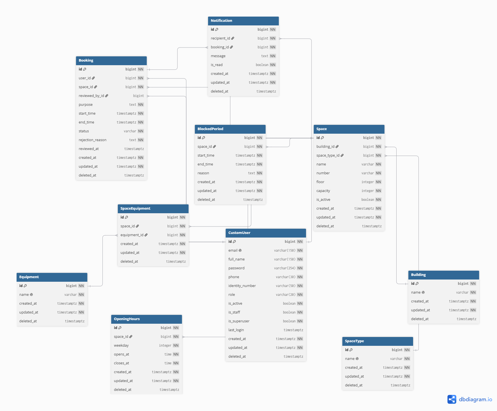

# Roomly

Roomly is a university room and coworking reservation system built with Django.
It helps staff manage rooms, weekly availability, booking requests, and
notifications for students and teachers.

This midterm implementation provides five domain applications and a customized
Django Admin interface powered by Unfold. All project workflows are available
at `/admin/`.

## Features

- Custom users with email login, university roles, and permission-based access.
- Room catalog with buildings, room types, capacity, and equipment.
- Weekly opening hours and one-off periods of unavailability.
- Booking validation for overlapping intervals, closed hours, and inactive rooms
  or applicants.
- Approval, rejection, cancellation, and manual completion of bookings.
- Manually created notification records with recipient validation and read status.
- Unfold Admin with light and dark themes, search, filters, autocomplete, and
  equipment and schedule inlines.

## Technology

| Component | Version / configuration |
| --- | --- |
| Python | 3.12 |
| Django | 5.2.18 |
| Django Unfold | 0.108.0 |
| python-decouple | 3.8 |
| PostgreSQL driver | psycopg[binary] 3.3.6 |
| Local database | SQLite |
| Production database configuration | PostgreSQL |
| Time zone | Asia/Qyzylorda, with `USE_TZ=True` |

Runtime dependencies are pinned in [requirements.txt](requirements.txt).

## Project structure

~~~text
roomly/
|-- apps/
|   |-- abstracts/
|   |-- users/
|   |-- spaces/
|   |-- bookings/
|   |-- schedules/
|   `-- notifications/
|-- settings/
|   |-- base.py
|   |-- conf.py
|   |-- env/
|   |   |-- local.py
|   |   `-- prod.py
|   |-- urls.py
|   |-- wsgi.py
|   `-- asgi.py
|-- docs/
|-- .env.example
|-- manage.py
|-- requirements.txt
`-- README.md
~~~

Each domain application contains its models, Admin configuration, and committed
migrations. The configuration layout follows the
[instructor's project structure](https://github.com/MaratulyTemirbolat/crm-django/tree/8b221654ecdbc444b8d5bb9322a28261a89ed4a5).

## Getting started

The commands below use Windows PowerShell and Python 3.12. They run the virtual
environment's Python directly, so activating the environment is optional.

### 1. Clone and install

Clone the `dev` branch containing the midterm implementation:

~~~powershell
git clone --branch dev https://github.com/SamuelStrand/roomly.git
cd roomly
py -3.12 -m venv .venv
.\.venv\Scripts\python.exe -m pip install -r requirements.txt
Copy-Item -LiteralPath .env.example -Destination .env
~~~

If you already have a `.env` file, keep it and skip the copy command.

On macOS or Linux, create the environment with `python3.12 -m venv .venv`,
copy the template with `cp .env.example .env`, and use `.venv/bin/python`
instead of `.\.venv\Scripts\python.exe` in the following commands.

### 2. Configure the local environment

Generate a Django secret key:

~~~powershell
.\.venv\Scripts\python.exe -c "from django.core.management.utils import get_random_secret_key; print(get_random_secret_key())"
~~~

Open `.env` and set:

~~~dotenv
ROOMLY_ENV_ID=local
ROOMLY_SECRET_KEY='paste-your-generated-secret-key-here'
~~~

Keep the generated key in single quotes. PostgreSQL variables from the example
file are read only when `ROOMLY_ENV_ID=prod`.

### 3. Create the database and administrator

~~~powershell
.\.venv\Scripts\python.exe manage.py check
.\.venv\Scripts\python.exe manage.py migrate
.\.venv\Scripts\python.exe manage.py createsuperuser
~~~

The superuser command asks for an email address, full name, and password.
The repository includes initial migrations for all five domain applications;
a normal installation uses `migrate`.

### 4. Start the development server

~~~powershell
.\.venv\Scripts\python.exe manage.py runserver
~~~

Open [http://127.0.0.1:8000/admin/](http://127.0.0.1:8000/admin/) and sign in
with the superuser's email and password. The project interface is under
`/admin/`; no homepage is configured at `/`.

## Environment configuration

[settings/base.py](settings/base.py) contains shared Django and Unfold settings.
[settings/conf.py](settings/conf.py) reads configuration through python-decouple.
CLI, WSGI, and ASGI select `settings.env.<ENV_ID>` consistently.

| Variable | Required in | Purpose |
| --- | --- | --- |
| `ROOMLY_ENV_ID` | local, prod | Select `local` or `prod` |
| `ROOMLY_SECRET_KEY` | local, prod | Django secret key |
| `ROOMLY_ALLOWED_HOSTS` | prod | Comma-separated explicit host names |
| `ROOMLY_POSTGRES_DB` | prod | Database name |
| `ROOMLY_POSTGRES_USER` | prod | Database user |
| `ROOMLY_POSTGRES_PASSWORD` | prod | Database password |
| `ROOMLY_POSTGRES_HOST` | prod | Database host |
| `ROOMLY_POSTGRES_PORT` | prod | Database port |

Process environment variables take precedence over `.env`. The `.env` file,
virtual environments, and local SQLite database are excluded from Git.

- `local`: SQLite at `db.sqlite3`, `DEBUG=True`, and localhost hosts.
- `prod`: PostgreSQL, `DEBUG=False`, and explicit allowed hosts.

To use `prod`, provide an existing PostgreSQL database and the required
variables before running migrations. The repository includes production
database settings; deployment infrastructure is outside the midterm scope.

## Users and permissions

`CustomUser` inherits from `AbstractBaseUser`, `PermissionsMixin`, and
`AbstractBaseModel`. It uses email as its login identifier and stores full name,
phone, identity number, and a university role.

Available roles are Student, Teacher, Headman, and Moderator. A role is a profile
attribute: access to Admin is controlled separately by `is_active`, `is_staff`,
groups, and permissions.

Superusers manage accounts, passwords, groups, and authorization. Authorized
moderators can view user profiles; password and permission fields are hidden,
and user changes remain restricted to superusers.

### Set up a moderator

Sign in as a superuser:

1. Open **Groups** and create a group named **Moderators**.
2. Assign the permissions listed below.
3. Create or edit the moderator in **Users**.
4. Set the role to **Moderator**, enable **Active** and **Staff**, and add the
   account to **Moderators**. Leave **Superuser** disabled.
5. Set a password and sign in with that account to verify its access.

| Models | Moderator permissions |
| --- | --- |
| CustomUser | View only |
| Building, SpaceType, Equipment, Space, SpaceEquipment | View, add, change |
| Booking | View, add, change |
| OpeningHours, BlockedPeriod | View, add, change |
| Notification | View, add, change; includes marking records as read |
| Groups and authorization | No management permissions |

Moderator delete permissions are omitted. Superusers can remove one-off
blocked periods. User passwords can be changed from the user's Admin card;
ordinary profile edits preserve the existing password hash.

## Using Roomly Admin

Use **All applications** in the sidebar to find the domain models.

### Prepare the catalog and schedule

1. Add a **Building**, **Space type**, and one or more **Equipment** items.
2. Create a **Space** with a room number, floor, capacity, and active status.
3. Add equipment through its inline on the Space page.
4. Add **Opening hours** through the Space inline or the standalone model page.
5. Add a **Blocked period** when the room is unavailable for maintenance or
   another event.

Room numbers are unique within a building, capacity must be positive, and the
same equipment item can be linked to a room only once.

### Create and review a booking

1. Create the applicant in **Users** as a Student, Teacher, or Headman.
2. In **Bookings**, select the applicant and room, enter a purpose, and choose
   a future start and end time within the room's opening hours.
3. Save the request. Its initial status is **Pending**.
4. Open the request to approve, reject, or cancel it. Rejection requires a reason.
5. After an approved booking ends, set it to **Completed** manually.

The Admin records the reviewing user and review time when a booking is approved
or rejected. Applicant changes are prohibited after creation; room, purpose,
and interval can be changed only while the booking is pending.

### Create a notification

Open **Notifications**, select a booking and its applicant as the recipient,
enter a message, and save. New notifications are unread. Existing message text
and relations are read-only; staff with change permission can edit read status
or use **Mark selected unread notification as read**.

Notifications are created manually in Admin. Booking changes do not generate
notifications or send email automatically.

## Booking and schedule rules

| Current status | Allowed next statuses |
| --- | --- |
| `pending` | `approved`, `rejected`, `cancelled` |
| `approved` | `cancelled`, `completed` |
| `rejected`, `cancelled`, `completed` | No further transitions |

- Pending and approved bookings reserve their time intervals.
- Identical, partially overlapping, and nested intervals are rejected.
  Back-to-back bookings are allowed, and an edited booking excludes itself.
- An overlap exists when `existing.start_time < new.end_time` and
  `existing.end_time > new.start_time`.
- Start must be before end. New and rescheduled requests require active
  applicants and rooms and must start in the future. Approval must also occur
  before the start.
- A booking must fit inside a single opening interval on one local date.
  Weekdays use `0=Monday` through `6=Sunday`; a missing schedule means closed.
- One-off blocked periods prevent overlapping bookings.
- Schedule changes cannot invalidate upcoming or ongoing pending/approved
  bookings.
- Rejection and cancellation free the interval. Completion is available only
  after an approved booking ends.

Validation is implemented in model `clean()` methods and is called by Admin
forms. Django's ordinary `save()` does not call `full_clean()`: when creating or
editing domain records from the shell, call `full_clean()` before `save()`.

## Timestamps and deletion

All ten concrete domain models inherit `created_at`, `updated_at`, and nullable
`deleted_at` from `AbstractBaseModel`.

Calling `instance.delete()` marks the record by setting only `deleted_at`.
It retains the row, primary key, activity flag, and update timestamp. Marked
rows remain visible to normal queries and retain their unique values.
`QuerySet.delete()` performs physical deletion and applies relation policies
such as PROTECT, CASCADE, and SET_NULL.

Admin uses explicit policies for each workflow:

| Records | Admin behavior |
| --- | --- |
| Users | Superuser-only **Mark selected users as deleted** action; disable **Active** to prevent login |
| Buildings, room types, equipment, rooms | Standard deletion disabled; rooms can be deactivated |
| Room-equipment links | Removing an inline link physically deletes the association |
| Bookings | Deletion disabled; cancel or reject to release time |
| Opening hours | Deletion disabled, including inlines |
| Blocked periods | Single and bulk deletion physically remove selected blocks and release their intervals |
| Notifications | Deletion disabled; records can be marked read |

Marking a user as deleted does not deactivate the account. Marking an active
booking does not cancel it or release its interval.

## Database diagram

The diagram covers the ten domain models. Django's built-in authentication,
session, content type, and Admin log tables are omitted for readability.

## Development checks

Run from the project root:

~~~powershell
.\.venv\Scripts\python.exe manage.py check
.\.venv\Scripts\python.exe manage.py makemigrations --check --dry-run
.\.venv\Scripts\python.exe -m pip check
~~~

When changing a model, generate and commit the corresponding migration:

~~~powershell
.\.venv\Scripts\python.exe manage.py makemigrations
.\.venv\Scripts\python.exe manage.py migrate
~~~
